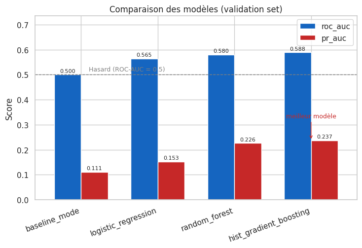
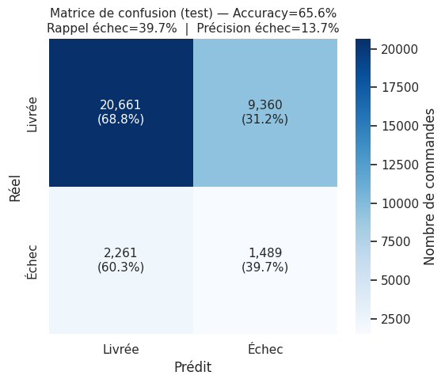
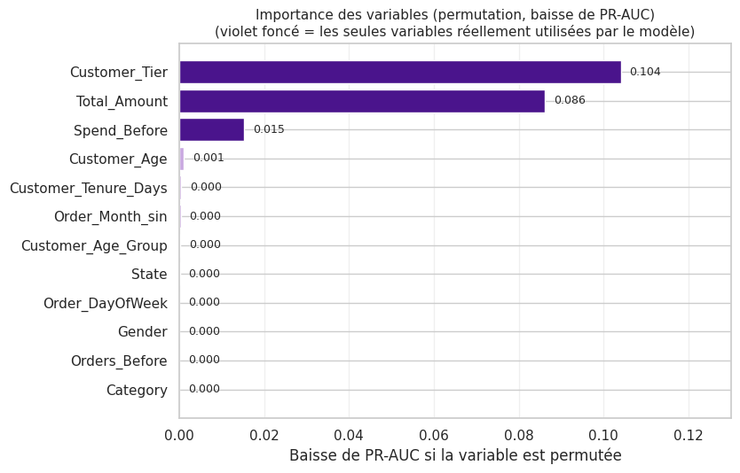
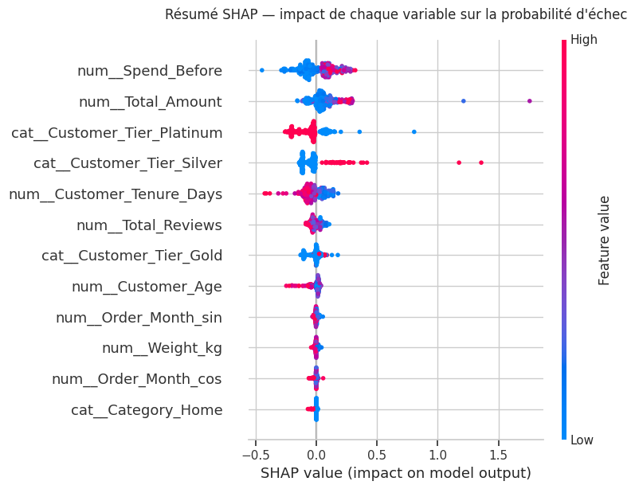

# Prédiction du risque d'annulation ou de retour d'une commande e-commerce


Pipeline de data science complet, en **20 phases** (du cadrage métier à l'audit d'équité), pour prédire si une commande e-commerce sera **annulée ou retournée** à partir des données de **ventes**, **clients** et **produits**.

Le projet met l'accent sur la **rigueur méthodologique** : détection de deux fuites de données, recalcul de variables « point-in-time », découpage strict train / validation / test, choix de métriques adaptées au déséquilibre des classes, et **restitution honnête** d'un signal prédictif faible.

---

## Sommaire
- [Problème métier](#problème-métier)
- [Données](#données)
- [Résultats](#résultats)
- [Points méthodologiques clés](#points-méthodologiques-clés)
- [Les 20 phases](#les-20-phases)
- [Installation et exécution](#installation-et-exécution)
- [Structure du dépôt](#structure-du-dépôt)
- [Limites et pistes d'amélioration](#limites-et-pistes-damélioration)
- [Auteur](#auteur)

---

## Problème métier

**Question :** quelles commandes risquent d'être annulées ou retournées ?
Une prédiction fiable permettrait d'intervenir **avant** l'échec : relance du client, contrôle qualité renforcé, offre de remplacement.

**Cible :** `is_failed = 1` si `Order_Status ∈ {Cancelled, Returned}`, `0` si `Delivered`. Les commandes `Processing` / `Shipped` sont exclues, car leur issue n'est pas encore connue.

## Données

Trois tables (archive `data/ecommerce_data.zip`) :

| Fichier | Lignes | Colonnes | Contenu |
|---|---:|---:|---|
| `sales.csv` | 250 000 | 21 | Commandes : date, montant, remise, livraison, paiement, statut… |
| `customers.csv` | 40 000 | 15 | Clients : âge, genre, région, niveau (Platinum / Gold / Silver), ancienneté… |
| `products.csv` | 2 000 | 12 | Produits : catégorie, marque, prix, stock, poids, note moyenne… |

Après fusion et filtrage : **225 134 commandes** à issue connue, dont **11,1 % en échec** (déséquilibre ≈ 8:1).
Découpage stratifié : **train 70 %** (157 593) · **validation 15 %** (33 770) · **test 15 %** (33 771).

## Résultats

### Comparaison des modèles (jeu de validation)

| Modèle | ROC-AUC | PR-AUC |
|---|---:|---:|
| Baseline (classe majoritaire) | 0.500 | 0.111 |
| Régression logistique | 0.565 | 0.153 |
| Random Forest | 0.580 | 0.226 |
| **HistGradientBoosting** | **0.588** | **0.237** |

### Évaluation finale (jeu de test, jamais vu pendant l'entraînement)

Modèle retenu : **HistGradientBoosting**, optimisé par `RandomizedSearchCV` (validation croisée stratifiée à 3 plis, critère PR-AUC).

| Métrique | Valeur | Référence |
|---|---:|---|
| ROC-AUC | **0.578** | 0.500 = hasard |
| PR-AUC | **0.217** | 0.111 = taux d'échec de base (× 2) |
| F1 (classe « échec ») | 0.204 | — |
| Rappel (classe « échec ») | 39.7 % | 1 489 échecs détectés sur 3 750 |
| Précision (classe « échec ») | 13.7 % | 9 360 fausses alertes |





### Ce qui pilote la prédiction

Seules **trois variables** portent un signal réel : `Customer_Tier`, `Total_Amount` et `Spend_Before`. Les quelque 20 autres apportent une contribution quasi nulle.

| Importance par permutation | Valeurs SHAP |
|---|---|
|  |  |

**Conclusion :** le jeu de données contient un **signal prédictif faible** pour cette tâche. Le modèle double la précision par rapport au hasard (PR-AUC 0.217 contre 0.111). Il peut servir d'**aide à la priorisation sous supervision humaine**, mais pas de décision automatique.

## Points méthodologiques clés

### 1. Deux fuites de données détectées et corrigées
- **`Rating` / `Review_Text`** : ces champs ne sont renseignés qu'**après livraison** (100 % manquants pour les commandes annulées ou retournées). Les utiliser reviendrait à donner la réponse au modèle → **exclus**.
- **`Total_Orders` / `Total_Spent`** (table clients) : ce sont des agrégats calculés sur **tout l'historique**, y compris les commandes futures (corrélation de 0,95 avec la dépense totale réelle). Ils ont été remplacés par des variables **point-in-time** recalculées à la date de chaque commande : `Orders_Before`, `Spend_Before`.

### 2. Prétraitement sans fuite
`ColumnTransformer` (`RobustScaler` pour 17 variables numériques, `OneHotEncoder` pour 9 variables catégorielles) **ajusté uniquement sur le train**, et intégré au `Pipeline` scikit-learn sauvegardé.

### 3. Déséquilibre des classes
`class_weight="balanced"` plutôt que SMOTE (pas de données synthétiques ni de risque de fuite), et **PR-AUC** comme métrique principale plutôt que l'accuracy (un modèle qui prédit toujours « livrée » atteint 88,9 % d'accuracy).

### 4. Multicolinéarité
Analyse VIF : `Unit_Price`, `Order_Value` et `Total_Amount` sont redondants → seul `Total_Amount` est conservé (+ `Discount_Ratio`). `Shipping_Cost` est remplacé par `Shipping_Ratio`.

### 5. Audit d'équité
| Niveau client | Taux d'échec réel | Taux prédit « échec » |
|---|---:|---:|
| Platinum | 10.1 % | 25.5 % |
| Gold | 13.1 % | 34.9 % |
| Silver | 15.9 % | **80.2 %** |

Le modèle **sur-cible fortement les clients Silver** : c'est l'effet combiné de `class_weight="balanced"` et de la dominance de `Customer_Tier`. En production, il faudrait **ajuster le seuil de décision** selon le coût métier réel des fausses alertes, plutôt que d'utiliser un seuil brut de 0,5.

### 6. Monitoring
Fonction **PSI** (*Population Stability Index*) réutilisable pour détecter une dérive des données. Exemple : `Total_Amount` entre train et test, PSI = 0,0005 (stable). Seuil de réentraînement proposé : PSI > 0,25.

## Les 20 phases

| # | Phase | # | Phase |
|---|---|---|---|
| 0 | Cadrage métier | 11 | Découpage stratifié 70 / 15 / 15 |
| 1 | Collecte et fusion des 3 tables | 12 | Modélisation (baseline + 3 familles) |
| 2 | EDA et détection de fuite | 13 | Validation croisée et optimisation |
| 3 | Nettoyage | 14 | Évaluation finale sur le test |
| 4 | Valeurs manquantes | 15 | Interprétabilité (permutation, SHAP) |
| 5 | Valeurs aberrantes (IQR) | 16 | Visualisation (7 graphiques) |
| 6 | Analyse statistique (χ², Mann-Whitney, VIF) | 17 | Reproductibilité (métriques + modèle) |
| 7 | Feature engineering (point-in-time) | 18 | Déploiement (pipeline joblib) |
| 8 | Encodage et mise à l'échelle | 19 | Monitoring (PSI) |
| 9 | Déséquilibre des classes | 20 | Éthique, biais et gouvernance |
| 10 | Sélection de variables (information mutuelle, importance embedded) | | |

Détail de chaque phase : [PIPELINE.md](PIPELINE.md).

## Installation et exécution

### En local
```bash
git clone https://github.com/Minyurano/Pipeline-ML-complet-20-phases-pour-pr-dire-le-risque-d-annulation-retour-d-une-commande-e-commerce-.git
cd Pipeline-ML-complet-20-phases-pour-pr-dire-le-risque-d-annulation-retour-d-une-commande-e-commerce-
pip install -r requirements.txt

# Décompresser les données dans data/
python -c "import zipfile; zipfile.ZipFile('data/ecommerce_data.zip').extractall('data')"

python src/pipeline.py
```
Durée : environ 3 à 4 minutes sur un ordinateur portable. Résultats générés dans `outputs/` : `metrics.json`, `model_pipeline.joblib` et `plots/*.png`.

### Sur Kaggle
Importer `notebooks/pipeline_ecommerce_kaggle.ipynb`, attacher un dataset contenant les trois CSV via **Add Input**, puis **Run All**. Le chemin des données est détecté automatiquement.

### Réutiliser le modèle entraîné
```python
import joblib
model = joblib.load("outputs/model_pipeline.joblib")   # prétraitement + modèle
proba_echec = model.predict_proba(nouvelles_commandes)[:, 1]
```

## Structure du dépôt

```
.
├── src/
│   └── pipeline.py                        # Pipeline complet (exécutable en script)
├── notebooks/
│   └── pipeline_ecommerce_kaggle.ipynb    # Exécution de référence sur Kaggle, avec sorties
├── data/
│   └── ecommerce_data.zip                 # sales.csv, customers.csv, products.csv
├── assets/                                # Graphiques des résultats
├── PIPELINE.md                            # Détail des 20 phases
├── requirements.txt
├── LICENSE
└── README.md
```

## Limites et pistes d'amélioration
- **Signal faible :** ROC-AUC ≈ 0,58. Les variables disponibles expliquent peu les annulations et retours. Il faudrait des données plus riches : historique de navigation, retards logistiques réels, échanges avec le service client.
- **Seuil de décision :** l'optimiser selon une matrice de coûts métier (coût d'une fausse alerte contre coût d'un échec non détecté).
- **Équité :** sur-ciblage des clients Silver. À traiter par un ajustement de seuil par groupe ou un post-traitement de type *equalized odds*.
- **Calibration** des probabilités (`CalibratedClassifierCV`) avant un usage en score de risque.
- **Déploiement :** exposer `model_pipeline.joblib` via une API (FastAPI) avec authentification, validation des entrées et journalisation.

## Auteur

**Aloys MINYURANO** — Master Intelligence Artificielle & Sciences des Données (IASD), FST de Tanger
[GitHub](https://github.com/Minyurano) · [LinkedIn](https://www.linkedin.com/in/aloys-minyurano-871717402)

Distribué sous licence [MIT](LICENSE).
